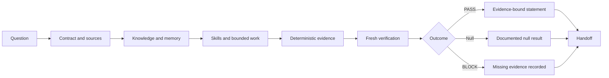

# Architecture

Agent+ supports ordinary project work and controlled research. Ordinary work follows the existing task, implementation and focused check. The diagram below describes the research path, not a mandatory sequence for every edit. Agent+ does not automate scientific judgment.

## Components

**Research contract.** States the decision, question, population, temporal boundary, target, comparator, evidence needed, and permitted claim before result review.

**Curated knowledge and memory.** The Obsidian Brain holds durable sources, decisions, and methods. Project memory holds changing verified state. Handoffs preserve one task boundary.

**Specialized skills.** Skills encode small repeatable procedures. They do not grant scientific authority or bypass the contract.

**Bounded model work.** A model receives only the files, authority, budget, and acceptance rule needed for a task.

**Deterministic evidence.** Code, schemas, source logs, hashes, fixtures, and tests establish facts that can be independently checked.

**Fresh verification.** A reviewer examines changed evidence from a clean context. The reviewer may accept, reject, narrow, or block the work.

**Human decision.** A person owns the decision to promote a verified result into a research or operational claim.

## Role separation

| Role | May do | May not do |
| --- | --- | --- |
| Maker | Produce a bounded artifact. | Certify its own result. |
| Evaluator | Run approved deterministic checks. | Interpret beyond the contract. |
| Verifier | Independently inspect changed evidence. | Rewrite the maker artifact silently. |
| Human owner | Accept, narrow, defer, or stop a claim. | Treat generated prose as proof. |

## Canonical distribution seam

The Agent+ repository is the canonical module. These commands use `scripts/agent-plus`.
The map names existing checks and their limits. A test name alone does not prove every branch or platform.

| Capability | Expected behavior | Existing checks |
| --- | --- | --- |
| `init` | Create profile controls without replacing owner files. | [Workflow tests](../tests/test_workflow_defaults.py): all profiles. [Lifecycle tests](../tests/test_agent_plus_lifecycle.py): quoted paths and installed controls. [Repair tests](../tests/test_system_repairs.py): collisions, interruption and owner replacements or edits. |
| `adopt` | Register canonical controls in an existing project while preserving owned state and its fixed startup hook. | [Adoption tests](../tests/test_agent_plus_legacy_adoption.py): exact bytes, divergent bytes, missing or unsafe hooks, upgrade preservation. |
| `doctor` | Verify controls and distinguish structural checks from readiness. | [Lifecycle tests](../tests/test_agent_plus_lifecycle.py): missing controls, modes and manifest generations. [Repair tests](../tests/test_system_repairs.py): readiness hook execution. [Adoption tests](../tests/test_agent_plus_legacy_adoption.py): fixed hook in canonical and copied routes. |
| `status` | Report current controls, drift or an available update using the exact managed-set identity. | [Lifecycle tests](../tests/test_agent_plus_lifecycle.py): current install, drift, executable modes and historical generations. [Repair tests](../tests/test_system_repairs.py): changed source at the same version. |
| `upgrade` | Preserve project state, allow additive managed changes and reject collisions, removals and downgrades. | [Lifecycle tests](../tests/test_agent_plus_lifecycle.py): additive changes, downgrade refusal, same-version repair, races and transaction failures. |
| `recover --target` | Restore a pending transaction safely and remain usable after a partial restore failure. | [Lifecycle tests](../tests/test_agent_plus_lifecycle.py): killed upgrades, snapshot integrity, edited additions, partial restore, symlinks and repeat recovery. |
| `projects` | List registered names, roles and roots. | [Lifecycle tests](../tests/test_agent_plus_lifecycle.py): sorted names, explicit/default roles, missing registry and invalid entries. [JSON resource tests](../tests/test_json_resource_failures.py): malformed registry input. |
| `context NAME` | Run startup in the registered project, forward its exit status and report launch errors. | [Lifecycle tests](../tests/test_agent_plus_lifecycle.py): project directory, zero/nonzero status, unknown project, missing registry/startup and non-executable startup without permission changes. [Startup tests](../tests/test_astra_workspace.py) separately exercise the startup script itself. |

Recovery validates snapshot hashes, restores through copy-to-temp plus atomic replace, removes
only committed candidate additions and retains recovery assets across partial restore failures.
The initializer's internal `record` operation is exercised by installation tests.

Project instructions, memory, planning state, evidence, data, and mutable ledgers stay behind the
consumer project seam. They are not Agent+ managed files. Project-specific rules live in
`.agent-plus/PROJECT.md`. This separation lets Agent+ evolve without replacing scientific state.

Skills provide bounded procedures after installation. They do not replace the repository,
installation manifest, project controls, or verification commands.

## Other capabilities and checks

| Capability | Existing checks and boundary |
| --- | --- |
| Project startup and bounded context | [Startup tests](../tests/test_astra_workspace.py) cover complete current instructions, historical boundaries, unsafe paths and missing controls. [Adoption tests](../tests/test_agent_plus_legacy_adoption.py) cover fixed startup hooks. |
| Formal task and chain controls | [Anti-loop tests](../tests/test_anti_loop_guard.py) and [active-chain tests](../tests/test_active_chain_guard.py) cover admission, role/stage order, honest terminal states and failure limits. These validate control records, not scientific truth. |
| Interface and consumer evidence | [Consumer-guard tests](../tests/test_interface_consumer_guard.py) cover declared/discovered consumers, receipt bindings and required smoke evidence. [Repair tests](../tests/test_system_repairs.py) cover consumers outside declared roots. |
| Workflow outcome measurement | [Outcome-audit tests](../tests/test_outcome_audit.py) cover known-answer metrics, denominators, failure history and private receipt boundaries. |
| Skill routes, handoffs and prose preservation | [Workflow tests](../tests/test_workflow_defaults.py) and [discovery tests](../tests/test_astra_workspace.py) cover instruction bindings, unique metadata and mirrors. [Editorial tests](../tests/test_editorial_pass.py) cover protected evidence. These do not establish writing quality or universal agent compliance. |
| Exact candidate verification | [Verifier tests](../tests/test_release_candidate_verifier.py) cover scope, raw bytes/modes, isolated Git, hostile environments, mutation detection, receipts and private diagnostics. The verifier retains its zero-option release entrypoint. |
| CI and public package checks | [CI](../.github/workflows/validate.yml) calls the same pinned type/lint/package checks with explicit public output. [Verifier tests](../tests/test_release_candidate_verifier.py) cover streaming opt-in and private defaults. [Repair tests](../tests/test_system_repairs.py) cover public inventory, privacy, links and whitespace. |

## Coverage gaps and evidence limits

1. **Published-archive installation is not exercised by the checkout suite.** Archive byte identity
   and checkout lifecycle tests are separate evidence. A disposable archive-to-`init`/`doctor`/`status`
   smoke would check that complete delivery path.
2. **Platform claims require an executed run.** CI targets Ubuntu/Python 3.13. A local macOS pass
   does not exercise the Linux installer path or establish that the current bundle passed GitHub CI.

These findings do not introduce new approval gates. Track current run evidence in the existing
project record and use existing test files for any approved follow-up.
